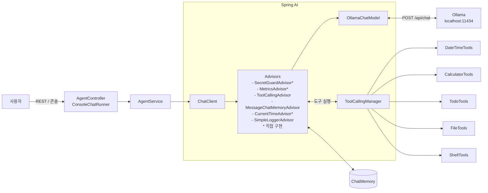

# 01. 프로젝트 개요

## 무엇을 만드나?
Spring AI 와 로컬 LLM(Ollama)을 이용한 **도구 호출(Tool Calling) 에이전트**입니다.
사용자의 질문을 받아 LLM 이 스스로 "어떤 도구를 쓸지" 판단하고, 도구 실행 결과를 바탕으로 답합니다.

## 에이전트(Agent)란?
일반 챗봇은 **말만** 합니다. 에이전트는 **도구를 사용해 행동**할 수 있습니다.

| 구분 | 챗봇 | 에이전트 |
|---|---|---|
| 지금 몇 시야? | 학습 데이터로 추측 (틀림) | 시간 도구 호출 → 정확한 시간 |
| 123.45 × 678 | 암산 (자주 틀림) | 계산기 도구 호출 → 정확한 값 |
| 할 일 추가해줘 | "추가했어요"라고 말만 함 | TODO 도구 호출 → 실제로 저장 |

핵심 아이디어는 단순합니다.
> LLM 은 **무엇을 할지 결정**하고, 실제 **실행은 우리 코드(도구)** 가 한다.

## 전체 구조



## 소스 구조

```
src/main/kotlin/com/example/springai/
├── SpringAiApplication.kt      # 진입점
├── config/
│   ├── AgentConfig.kt          # ★ ChatClient 조립 (시스템 프롬프트, Advisor, Tool)
│   └── AgentProperties.kt      # agent.* 설정값 바인딩
├── advisor/                    # 직접 만든 어드바이저 (docs/08)
│   ├── AdvisorOrders.kt        # 어드바이저 실행 순서 상수
│   ├── SecretGuardAdvisor.kt   # 비밀키가 보이면 모델 호출 없이 거절
│   ├── MetricsAdvisor.kt       # 소요 시간·토큰 측정
│   └── CurrentTimeAdvisor.kt   # 현재 시각 주입
├── agent/
│   ├── AgentService.kt         # ★ 에이전트 호출 (chatClient.prompt()...call())
│   └── UserContext.kt      # 사용자 ID 를 ToolContext 로 전달 (docs/09)
├── tools/                      # ★ @Tool 도구들
│   ├── DateTimeTools.kt
│   ├── CalculatorTools.kt
│   ├── TodoTools.kt
│   ├── FileTools.kt
│   ├── ShellTools.kt           # 셸 명령 실행 (보안 계층은 shell/ 패키지)
│   └── shell/
│       ├── CommandLineParser.kt  # 명령 한 줄 → 프로그램 + 인자 (셸 문법 거부)
│       ├── ShellPolicy.kt        # 허용 / 승인 필요 / 거부 판정
│       ├── CommandApprover.kt    # 사람 승인 (콘솔 y/N, REST 자동 거부)
│       ├── ShellExecutor.kt      # ProcessBuilder 실행 (타임아웃, 환경 변수 차단)
│       └── ProcessSandbox.kt     # OS 샌드박스 (macOS Seatbelt: 쓰기·네트워크 차단)
├── web/                        # REST API
│   ├── AgentController.kt
│   └── ChatDtos.kt
└── cli/
    └── ConsoleChatRunner.kt    # 콘솔 대화 모드 (cli 프로파일)

src/main/resources/
├── application.yml             # Ollama 연결, 모델, 로깅 설정
└── application-cli.yml         # 콘솔 모드 전용 설정 (cli 프로파일)

workspace/                      # 파일·셸 도구가 다룰 수 있는 유일한 폴더 (샌드박스)
└── AGENTS.md                   # 작업 환경 안내. 시작 시 시스템 프롬프트에 덧붙임 (읽기 전용으로 보호)
```

**처음 읽는다면 ★ 표시된 파일을 `AgentConfig → AgentService → tools` 순서로 읽어보세요.**

## 다음 문서
- [02. 설치와 실행](02-setup-and-run.md)
- [03. 요청 처리 흐름](03-request-flow.md)
- [04. Spring AI 핵심 개념](04-spring-ai-concepts.md)
- [05. 도구(Tool) 설명과 추가 방법](05-tools.md)
- [06. 에이전트 내부 동작 원리](06-agent-internals.md)
- [07. 셸 명령 도구와 보안](07-shell-tool-security.md)
