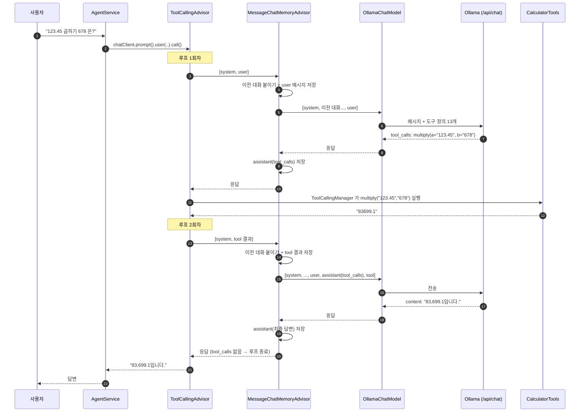

# 03. 요청 처리 흐름

"123.45 곱하기 678 은?" 이라는 요청 하나가 어떻게 처리되는지 따라가 봅니다.

## 어드바이저 체인 구성
`AgentConfig.kt` 에서 어드바이저를 다음 순서(order)로 배치했습니다. order 가 작을수록 바깥쪽입니다.
```
ChatClient.call()
 └ SecretGuardAdvisor          (HIGHEST_PRECEDENCE)      비밀키가 보이면 여기서 거절 (직접 구현)
    └ MetricsAdvisor "요청 전체" (+299)                   질문 1개 전체의 시간·토큰 (직접 구현)
       └ ToolCallingAdvisor      (+300)                  도구 호출 루프: tool_calls 가 없을 때까지 반복
          └ MessageChatMemoryAdvisor (+301)              루프의 매 회차마다: 기억 붙이기 / 새 메시지 저장
             └ CurrentTimeAdvisor     (+302)             현재 시각 주입, 기록에는 안 남음 (직접 구현)
                └ MetricsAdvisor "LLM 1회" (+303)         LLM 호출 1번의 시간·토큰 (직접 구현)
                   └ SimpleLoggerAdvisor   (+304)         매 회차의 LLM 요청/응답 로그
                      └ OllamaChatModel  ──→  POST /api/chat
```
직접 구현한 어드바이저 3개는 [08장](08-custom-advisors.md)에서 설명합니다.
도구 루프를 ChatModel 내부가 아니라 **어드바이저 체인에서** 돌리는 것이 핵심입니다.
그래야 메모리 어드바이저가 tool_calls 와 도구 결과까지 저장할 수 있습니다. (이유는 맨 아래 참고)

## 시퀀스 다이어그램



**이 루프는 Spring AI 가 자동으로 처리합니다.** 우리 코드에는 반복문이 없고,
`AgentService` 의 `.call().content()` 한 줄 안에서 모두 일어납니다.

## Ollama `/api/chat` 에 실제로 오가는 데이터

### ① 첫 번째 요청 (Spring AI → Ollama)
```json
POST http://localhost:11434/api/chat
{
  "model": "qwen3:8b",
  "stream": false,
  "messages": [
    { "role": "system", "content": "당신은 사용자를 돕는 친절한 한국어 비서 에이전트입니다. ..." },
    { "role": "user",   "content": "123.45 곱하기 678 은?" }
  ],
  "tools": [
    {
      "type": "function",
      "function": {
        "name": "multiply",
        "description": "두 수를 곱합니다 (a * b).",
        "parameters": {
          "type": "object",
          "properties": {
            "a": { "type": "string", "description": "첫 번째 수" },
            "b": { "type": "string", "description": "두 번째 수" }
          },
          "required": ["a", "b"]
        }
      }
    }
    // ... 나머지 10개 도구 정의
  ],
  "options": { "temperature": 0.2 },
  "think": false
}
```
- `tools` 는 `@Tool` / `@ToolParam` 어노테이션에서 자동 생성됩니다.
- 대화 기억이 있다면 `system` 과 `user` 사이에 이전 `user`/`assistant` 메시지들이 들어갑니다.

### ① 의 응답 (Ollama → Spring AI)
```json
{
  "model": "qwen3:8b",
  "message": {
    "role": "assistant",
    "content": "",
    "tool_calls": [
      { "function": { "name": "multiply", "arguments": { "a": "123.45", "b": "678" } } }
    ]
  },
  "done": true
}
```
`content` 가 비어 있고 `tool_calls` 가 있습니다 → "이 도구를 실행해 주세요"라는 뜻입니다.

### ② 두 번째 요청 (도구 결과 포함)
```json
{
  "model": "qwen3:8b",
  "messages": [
    { "role": "system",    "content": "..." },
    { "role": "user",      "content": "123.45 곱하기 678 은?" },
    { "role": "assistant", "content": "", "tool_calls": [ { "function": { "name": "multiply", "arguments": {"a":"123.45","b":"678"} } } ] },
    { "role": "tool",      "content": "83699.1" }
  ],
  "tools": [ ... ]
}
```

### ② 의 응답
```json
{ "message": { "role": "assistant", "content": "83,699.1입니다." }, "done": true }
```
`tool_calls` 가 없으므로 Spring AI 는 루프를 끝내고 이 텍스트를 최종 답변으로 반환합니다.

## 대화 기억은 어떻게 저장되나?
메모리 어드바이저가 루프 안쪽에 있으므로 **도구 메시지까지 모두** 저장됩니다. (실제 캡처한 요청 기준)
```
ChatMemory["demo-1"] = [
  user      "지금 서울 몇 시야?"
  assistant tool_calls=[getCurrentDateTime]
  tool      "2026-11-04 21:40:17 (수요일) KST"
  assistant "지금 서울 시간은 ... 21시 40분 17초입니다."
  user      "123.45 곱하기 678 은?"
  assistant tool_calls=[multiply]
  tool      "83699.1"
  assistant "123.45 × 678 = 83,699.1입니다."
  ...  (최근 40개까지 유지: agent.memory-max-messages)
]
```
- 시스템 프롬프트는 저장하지 않고 매 요청마다 `defaultSystem` 으로 새로 붙습니다.
- 40개를 넘으면 오래된 것부터 지우되, 남은 기록이 항상 `user` 메시지로 시작하도록 턴 단위로 자릅니다.

### 왜 도구 메시지까지 저장해야 하나?
기본 구성(메모리 어드바이저만 사용)에서는 도구 루프가 ChatModel 내부에서 돌아서, 기억에는
`user → assistant(최종답변)` 만 남습니다. 그러면 모델이 보는 대화 기록은 "질문하면 도구 없이 바로 답한다"는
패턴뿐이라, 몇 턴 뒤부터 도구를 부르지 않고 답을 지어냅니다. 이 프로젝트에서 실측한 결과:

| 같은 질문 "hello.txt 읽어줘" | 도구 호출 성공 |
|---|---|
| 대화 기록 없음 | 4/4 |
| 대화 기록 2턴 (도구 메시지 없이 저장된 기존 방식) | **0/4** → 가짜 파일 내용 출력 |
| ToolCallingAdvisor 적용 후 9턴 대화 | 8/8 (도구가 필요한 모든 턴) |
