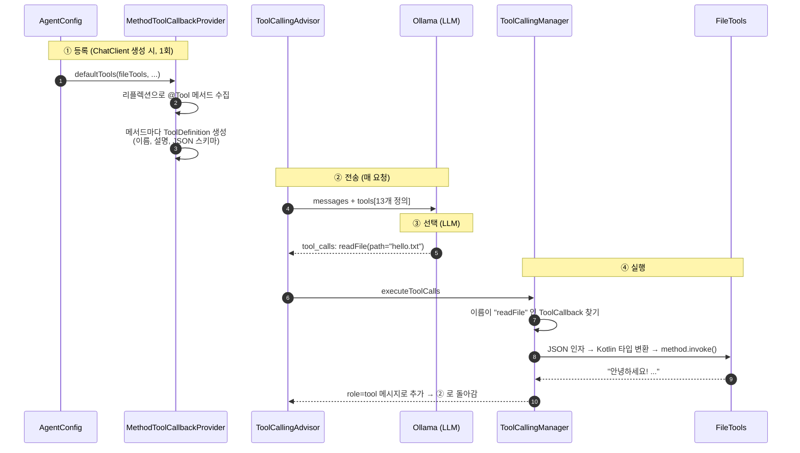

# 06. 에이전트 내부 동작 원리

이 문서는 두 가지 질문에 답합니다.
1. 에이전트의 흐름은 **누가** 제어하는가?
2. Spring AI 는 `@Tool` 메서드를 **어떻게** 인식하고, 모델은 어떻게 도구를 고르는가?

> 아래 클래스명과 기본값은 Spring AI **2.0.2** 소스를 직접 확인한 내용입니다.
> (`spring-ai-model`, `spring-ai-client-chat` sources jar)

---

## 1. 흐름 제어: "결정"과 "실행"은 다른 곳에서 일어난다

| 역할 | 담당 | 이 프로젝트에서 |
|---|---|---|
| **결정**: 어떤 도구를, 어떤 인자로, 더 부를지 / 이제 답할지 | **LLM** | `qwen3:8b` 가 응답에 `tool_calls` 를 넣을지 말지 |
| **실행**: tool_calls → 도구 실행 → 결과 전달 → 재호출 반복 | **`ToolCallingAdvisor`** | `config/AgentConfig.kt` 에서 등록 |
| **개입**: 요청·응답을 바꾸거나 막기 | **Advisor 들** | `MessageChatMemoryAdvisor`, `SimpleLoggerAdvisor` |
| **안전장치**: 무한 반복 방지 | **`ToolCallingManager`** 설정 | 기본값 사용 |
| **업무 단계 순서**: 1단계 요약 → 2단계 분류 … | **우리 코드** | 아직 없음 (`AgentService` 에서 구현할 자리) |

### 1-1. LLM 이 결정한다
에이전트의 본질은 **"다음에 무엇을 할지"를 코드의 if/for 가 아니라 LLM 이 정한다**는 점입니다.

```
사용자: "할 일 목록 보여주고 1번 완료해줘"

LLM 판단 ①  → tool_calls: listTodos()
LLM 판단 ②  → tool_calls: completeTodo(1)     (①의 결과를 보고 결정)
LLM 판단 ③  → content: "1번 '우유 사기'를 완료했습니다."  (tool_calls 없음 → 종료)
```
우리 코드 어디에도 "목록 조회 후 완료 처리" 같은 순서는 적혀 있지 않습니다.

### 1-2. ToolCallingAdvisor 가 루프를 돌린다
루프 자체는 판단을 하지 않습니다. 하는 일은 아래가 전부입니다.
```kotlin
do {
    response = 안쪽_체인.nextCall(request)        // 메모리 → 로거 → ChatModel → Ollama
    isToolCall = response 에 tool_calls 가 있는가?
    if (isToolCall) {
        result = toolCallingManager.executeToolCalls(...)   // 도구 실행
        request = 다음 요청(도구 결과 포함)
    }
} while (isToolCall)                               // tool_calls 가 없으면 종료
```
(실제 코드: `ToolCallingAdvisor.adviseCall()`)

그래서 **모델이 형식을 틀리거나 도구를 건너뛰면, 코드가 아무리 정확해도 흐름이 어긋납니다.**
([02. 문제 해결](02-setup-and-run.md#문제-해결-troubleshooting) 의 실측 사례 참고)

> **참고: 자동 등록**
> `ChatClient` 는 Advisor 체인에 도구 Advisor 가 없으면 `ToolCallingAdvisor` 를 **자동으로 끼워 넣습니다**
> (`spring.ai.chat.client.tool-calling.enabled`, 기본값 true). 도구 Advisor 는 체인에 **하나만** 허용되며,
> 2개 이상이면 `IllegalStateException` 이 발생합니다. 이 프로젝트는 동작을 코드로 드러내기 위해 직접 등록했습니다.

### 1-3. 코드로 흐름에 개입하는 방법

| 방법 | 효과 | 사용 예 |
|---|---|---|
| `ToolCallLimits` | 도구별 최대 **40회**, 전체 최대 **150회**(기본값). 넘으면 루프를 멈추고 알림을 답변으로 반환 | 모델이 같은 도구를 무한 반복할 때 |
| `@Tool(returnDirect = true)` | 도구 결과를 LLM 에 다시 보내지 않고 **바로 최종 답변**으로 반환, 루프 종료 | 결과를 가공 없이 그대로 보여줘야 할 때 |
| `ToolExecutionEligibilityChecker` | "이 응답에서 도구를 실행할지" 판단 기준 교체 | 특정 조건에서만 도구 실행 |
| 커스텀 Advisor | `chain.nextCall()` 을 부르지 않으면 요청 자체를 차단. 요청/응답 수정도 가능 | 금칙어 차단, 개인정보 마스킹, 재시도 |

### 1-4. 에이전트 vs 워크플로우
LLM 에게 흐름을 맡기면 유연하지만 예측하기 어렵습니다. 순서가 정해진 업무라면 **코드가 순서를 정하고**
각 단계에서만 LLM 을 호출하는 **워크플로우**가 더 안전합니다.

```kotlin
// 워크플로우 예: 순서는 코드가 결정
val summary  = chatClient.prompt().user("다음 글을 요약해: $text").call().content()
val category = chatClient.prompt().user("다음 요약을 분류해: $summary").call().content()
```

| | 에이전트 (이 프로젝트) | 워크플로우 |
|---|---|---|
| 다음 단계 결정 | LLM | 코드 |
| 장점 | 유연함, 예상 못한 요청도 처리 | 예측 가능, 테스트 쉬움 |
| 단점 | 모델 품질에 크게 좌우됨 | 정해진 경로만 처리 |

실무에서는 둘을 섞습니다. (예: 큰 흐름은 워크플로우, 특정 단계만 에이전트)

---

## 2. 도구 인식 원리

### 2-1. 컴포넌트 스캔이 아니라 "명시적 등록"
도구 클래스의 `@Component` 는 **`AgentConfig` 에 주입받기 위해서**일 뿐입니다.
도구 등록은 아래 한 줄이 명시적으로 합니다.

```kotlin
// config/AgentConfig.kt
.defaultTools(dateTimeTools, calculatorTools, todoTools, fileTools)
```

- `@Tool` 메서드가 있어도 여기에 **넘기지 않은 객체의 도구는 모델에게 전달되지 않습니다.**
- 실제 Ollama 요청을 캡처해 보면 `tools` 에 등록한 객체들의 `@Tool` 메서드 수만큼만 들어 있습니다.
  (셸 도구 추가 전: 4개 객체 → 12개, 추가 후: 5개 객체 → 13개)
- 요청마다 다른 도구를 주려면 호출 시점에 `.tools(...)` 로 지정합니다. ([05. 도구](05-tools.md) 참고)

### 2-2. 전체 과정 4단계



#### ① 등록 — `MethodToolCallbackProvider`
`defaultTools(객체)` 를 호출하면 객체의 메서드 중 `@Tool` 이 붙은 것을 **리플렉션**으로 찾아
메서드마다 `MethodToolCallback` 과 `ToolDefinition` 을 만듭니다.

| ToolDefinition 항목 | 만들어지는 곳 | 값 |
|---|---|---|
| `name` | `ToolUtils.getToolName()` | `@Tool(name = ...)` 이 있으면 그 값, 없으면 **메서드 이름** |
| `description` | `ToolUtils.getToolDescription()` | `@Tool(description = ...)` |
| `inputSchema` | `JsonSchemaGenerator.generateForMethodInput()` | 파라미터 타입 + `@ToolParam(description, required)` → JSON 스키마 |

같은 이름의 도구가 둘 이상이면 `IllegalArgumentException: Multiple tools with the same name ...` 이 발생합니다.

#### ② 전송 — 모델이 실제로 받는 것
매 요청마다 13개 도구 정의가 Ollama `/api/chat` 의 `tools` 필드에 실려 갑니다.
`FileTools.readFile` 의 경우 실제로 캡처된 정의는 다음과 같습니다.

```kotlin
@Tool(description = "작업 폴더(workspace) 안의 텍스트 파일 내용을 읽어옵니다.")
fun readFile(@ToolParam(description = "작업 폴더 기준 상대 파일 경로 (예: hello.txt)") path: String): String
```
⬇ 변환
```json
{
  "type": "function",
  "function": {
    "name": "readFile",
    "description": "작업 폴더(workspace) 안의 텍스트 파일 내용을 읽어옵니다.",
    "parameters": {
      "type": "object",
      "properties": {
        "path": { "type": "string", "description": "작업 폴더 기준 상대 파일 경로 (예: hello.txt)" }
      },
      "required": ["path"]
    }
  }
}
```

#### ③ 선택 — LLM 은 "글"만 보고 고른다
모델은 Kotlin 코드를 보지 못합니다. 위 JSON 의 **이름·설명·스키마 텍스트만** 보고 판단합니다.
- `description` 의 품질 = 도구 선택의 정확도
- "언제 사용하라"까지 써주면 좋습니다. (예: `DateTimeTools` 의 "사용자가 오늘 날짜, 현재 시각, 요일 등을 물을 때 사용하세요")
- 선택은 **확률적**입니다. 같은 도구 정의라도 모델에 따라 결과가 크게 다릅니다.

| 모델 (같은 도구 12개, 같은 질문 5개 × 3회, 셸 도구 추가 전 측정) | 성공 |
|---|---|
| `qwen3:8b` | 15/15 |
| `qwen3-coder:30b` | 6/15 |
| `qwen2.5-coder:7b` | 0/15 |

#### ④ 실행 — `ToolCallingManager` → `MethodToolCallback`
1. `tool_calls` 의 `name` 과 **이름이 같은** `ToolCallback` 을 찾습니다.
   없으면 `IllegalStateException: No ToolCallback found for tool name: ...`
2. `MethodToolCallback.call(JSON 문자열)`
   - JSON 인자를 메서드 파라미터 타입으로 변환 (`"1"` → `Long` 등)
   - `method.invoke(도구객체, 인자들)` 로 **우리 JVM 안에서** 실행
   - 반환값을 문자열로 변환 (`DefaultToolCallResultConverter`: 객체는 JSON 으로)
3. 결과를 `role=tool` 메시지로 대화에 추가하고 ② 로 돌아갑니다.

---

## 3. 정리: 결정적인 부분과 확률적인 부분

```
            결정적 (코드, 항상 같은 결과)          확률적 (LLM)
         ┌────────────────────────────────┐   ┌──────────────────┐
 ① 등록  │ 리플렉션으로 @Tool → 도구 정의   │   │                  │
 ② 전송  │ 도구 정의 JSON 을 요청에 포함    │   │                  │
 ③ 선택  │                                │   │ 어떤 도구? 인자?  │
         │                                │   │ 더 부를까? 끝낼까? │
 ④ 실행  │ 이름으로 찾아 method.invoke()   │   │                  │
 루프    │ tool_calls 있으면 반복          │   │                  │
         └────────────────────────────────┘   └──────────────────┘
```

**문제가 생겼을 때 진단 순서**
1. 도구 실행 로그(`Executing tool call: ...`, `[Tool] ...`)가 **있는가?**
   - **없다** → ③ 선택 단계 문제 (모델이 도구를 안 불렀거나 형식을 틀림)
     → 모델 교체, `description` 개선, 대화 기록 확인 ([02. 문제 해결](02-setup-and-run.md#문제-해결-troubleshooting))
   - **있다** → ④ 실행 이후 문제 (도구 로직, 인자 값)
     → 도구 단위 테스트로 확인 (`src/test/kotlin/.../tools/`)
2. 그래도 모르겠다면 LLM 요청/응답 전문 로그(`SimpleLoggerAdvisor`, REST 모드 기본 ON)를 봅니다.
